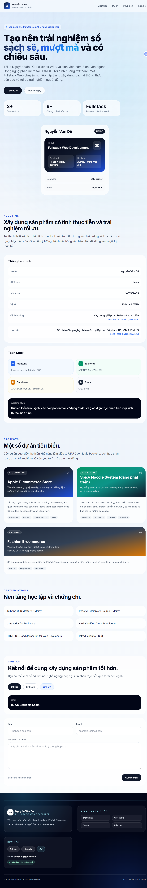

# Nguyễn Văn Dũ | Fullstack Developer Portfolio

> Một trang portfolio cá nhân theo phong cách Apple-style, tối giản, sạch sẽ và mượt mà. Dự án được xây dựng để giới thiệu năng lực, dự án, chứng chỉ và định hướng nghề nghiệp của Nguyễn Văn Dũ - sinh viên năm 3 chuyên ngành Công nghệ phần mềm tại HCMUE.

## ✨ Giới thiệu chung

**Nguyễn Văn Dũ | Fullstack Developer Portfolio** là website cá nhân được phát triển bằng **HTML**, **Tailwind CSS**, **JavaScript** và thư viện **AOS (Animate On Scroll)**.  
Giao diện được thiết kế theo phong cách hiện đại, tập trung vào trải nghiệm người dùng, khả năng đáp ứng trên nhiều thiết bị và bố cục trực quan để trình bày thông tin cá nhân, kỹ năng, dự án và liên hệ.

## 🖼️ Ảnh chụp giao diện (Screenshots)

> Bạn có thể thay các đường dẫn placeholder bên dưới bằng ảnh thực tế sau khi chụp màn hình.

### Desktop



| Loại ảnh | Đường dẫn placeholder       | Ghi chú                                 |
| -------- | --------------------------- | --------------------------------------- |
| Desktop  | `./assets/desktop-home.png` | Ảnh toàn bộ giao diện trên màn hình lớn |

## 🚀 Các tính năng nổi bật

- **Responsive Design**: Tối ưu hiển thị trên điện thoại, tablet và máy tính để bàn.
- **AOS Scroll Animation**: Hiệu ứng xuất hiện mượt mà khi cuộn trang.
- **Glassmorphism & Gradient UI**: Kết hợp nền kính mờ và các khối gradient hiện đại để tạo chiều sâu thị giác.
- **Contact Form**: Form liên hệ tích hợp gửi mail trực tiếp qua **FormSubmit API**.
- **Mobile Navigation**: Menu điều hướng tối ưu cho màn hình nhỏ với nút toggle.
- **Modern UI Layout**: Bố cục rõ ràng cho giới thiệu, dự án, chứng chỉ và liên hệ.

## 📌 Danh sách dự án

| Dự án                      | Mô tả ngắn                                                                                             | Công nghệ                                                       |
| -------------------------- | ------------------------------------------------------------------------------------------------------ | --------------------------------------------------------------- |
| **Apple E-commerce Store** | Website đồ công nghệ hiện đại, tập trung vào trải nghiệm mua sắm mượt mà và quản lý dữ liệu chặt chẽ.  | React, Next.js, Tailwind CSS, Node.js/Express Clerk Auth, MySQL |
| **Spicy Noodle System**    | Hệ thống đặt món thông minh tích hợp AI Chatbot và phân tích dữ liệu để hỗ trợ người dùng và quản trị. | AI Chatbot, React, Next.js, Node.js/Express, PostgreSql         |
| **Fashion E-commerce**     | Website thời trang tối ưu UI/UX, sử dụng Next.js và dữ liệu mô phỏng (Mock Data) chuyên nghiệp.        | Next.js, Mock Data, Responsive UI                               |

## 🧠 Kỹ năng & Công nghệ (Tech Stack)

| Nhóm         | Công nghệ                     |
| ------------ | ----------------------------- |
| **Frontend** | React, Next.js, Tailwind CSS  |
| **Backend**  | ASP.NET Core                  |
| **Database** | SQL Server, MySQL, PostgreSQL |
| **Tools**    | Git/GitHub                    |

## 🗂️ Cấu trúc thư mục

```bash
portfolio/
├── index.html      # Trang HTML chính, chứa cấu trúc nội dung và liên kết các phần của portfolio
├── styles.css      # File CSS tùy chỉnh cho hiệu ứng nền, glassmorphism, gradient và giao diện riêng
├── main.js         # File JavaScript xử lý AOS, form liên hệ và menu mobile
└── README.md       # Tài liệu mô tả dự án trên GitHub
```

## ⚙️ Hướng dẫn cài đặt và chạy local

### 1) Clone dự án

```bash
git clone <https://github.com/van-du-2005/Portfolio.git>
cd portfolio
```

### 2) Chạy bằng Live Server

- Mở thư mục dự án bằng **Visual Studio Code**.
- Cài extension **Live Server** nếu chưa có.
- Nhấp chuột phải vào `index.html` → chọn **Open with Live Server**.
- Trình duyệt sẽ mở giao diện portfolio trên localhost.

## 📬 Thông tin liên hệ

| Kênh         | Thông tin                                                                          |
| ------------ | ---------------------------------------------------------------------------------- |
| **Email**    | `dun3632@gmail.com`                                                                |
| **GitHub**   | https://github.com/van-du-2005                                                     |
| **LinkedIn** | https://linkedin.com/in/nguyen-van-du-fullstack-web                                |
| **CV**       | https://drive.google.com/file/d/1sdB4a5iKvcnj_T69Fy3GNvg6O689f4Xx/view?usp=sharing |

## 📝 Ghi chú khi gửi form liên hệ

- Form liên hệ đang được tích hợp qua **FormSubmit API**.
- Khi dùng lần đầu, bạn có thể cần xác nhận email kích hoạt từ FormSubmit để nhận tin nhắn.
- Nếu có lỗi gửi mail tự động, dự án sẽ hiển thị thông báo fallback để bạn kiểm tra lại email nhận.

## 🌟 Điểm mạnh của dự án

- Thể hiện tư duy thiết kế giao diện hiện đại và tối giản.
- Có cấu trúc nội dung rõ ràng, phù hợp cho hồ sơ cá nhân và tuyển dụng.
- Dễ triển khai, không cần backend riêng, phù hợp với hosting tĩnh như GitHub Pages, Netlify hoặc Vercel.
- Có thể tùy chỉnh nhanh để cập nhật dự án, chứng chỉ và thông tin liên hệ.
